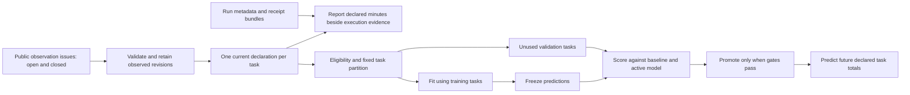

# Automatic public observation import and model improvement

The `Public observation learning demo` workflow runs on GitHub-hosted Ubuntu. It
imports explicit public effort observations, joins them to validated execution
receipts, evaluates a fixed candidate predictor and promotes it only when its
held-out results pass the configured gates. No private runner, workstation agent,
paid AI API or engineer timesheet is required to run this demo.

It does still need human observations to learn about human effort. GitHub timing
does not supply those labels. The live example imports the **3 declared human
minutes** in [EngArg #51](https://github.com/emmett08/engarg/issues/51), including
when that observation issue is closed. Its method and coverage were not supplied,
so the report displays it but excludes it from training. It does not claim to have
measured three minutes or improved real predictive accuracy.

The [verified hosted run](observation-learning-evidence/README.md) includes the
public report, imported revision and artifact verification metadata.

## Run the hosted demo

1. Open a PR changing the demo's code, configuration or workflow. A PR run starts
   with isolated state, imports the public issue and execution artifacts, and
   exercises a separately labelled synthetic learning example. Real declarations
   are observe-only: PR runs never fit or score a real model against a fresh copy
   of its holdout. They cannot update the scheduled collector's history.
2. After merging the workflow, select **Actions → Public observation learning
   demo → Run workflow** on the default branch and set `bootstrap` to `true` for
   the first trusted run. This is an explicit initialization, not a private
   infrastructure setup. Subsequent manual runs use the default `false`.
3. The schedule continues from the previous successful trusted checkpoint. Read
   the job summary and download the report and checkpoint artifacts. The report
   includes acquisition gaps, declared effort, linked receipts, model exclusions,
   held-out errors and the decision to promote, reject or wait for more data.
   Only trusted default-branch runs enable real-data model fitting.

The reusable workflow is also called by
[`observatory-instrumentation`](https://github.com/emmett08/observatory-instrumentation),
which distributes the issue form and adoption guide. Observation semantics,
validation, models and reporting belong here; consumer repositories supply public
observations and execution receipts.

The core and instrumentation demo workflows maintain independent checkpoint
histories over the same pilot sources. Their reports are duplicate demonstrations,
not independent studies or extra observations. Choose one canonical history for
any real study; do not pool their task counts or validation results.

## What runs automatically



The importer uses `state=all`, follows bounded pagination and explicitly refetches
known observation issues even if their titles changed. Repeated deliveries are
deduplicated by source and revision hashes. Closing an issue changes source
metadata; it does not add or remove a task's effort. Changed declarations remain
in immutable history. A rejected newest declaration never falls back to a valid
older value. Simultaneous conflicting versions are quarantined.

Only acquired revisions can be preserved: edits between API polls are unknown.
An incomplete scan prevents live model evaluation and prediction. The report
still shows saved declarations and marks that their latest revisions could not
be confirmed.

## Add real observations

Automation covers the public sources and task links registered in
[`public-config.json`](../examples/observation-learning/public-config.json).
Register the task's repository, issue, PRs and exact task/protocol IDs there;
register selected run IDs in
[`execution-manifest.json`](../examples/observation-learning/execution-manifest.json).
The driver checks that those links agree. New observation issues for a registered
task are discovered by the configured title prefix. Registering a new task still
requires a configuration change; the importer does not infer arbitrary links.

Use the versioned **Effort observation** form installed by the instrumentation
repository. An observation declares person-minutes, `timer`, `recall` or `unknown`
method, coverage and scope. Unknowns are valid reportable observations. Only
nonnegative totals with known method, `complete` coverage and `task_total` scope
can train this demo. Multiple observation issues claiming the same task total are
excluded together, even when their numbers agree. Resolve the source duplication
rather than summing overlapping reports. Timer and recall remain declarations;
neither is automatically verified ground truth.

The original unversioned EngArg #51 is supported by an explicit adapter restricted
to its known declaration body hash. Editing that prose requires migration to the
versioned form or schema; the importer never guesses a new number from prose.
The accepted machine-readable payload is described in
[`effort-observation-v1.schema.json`](../schemas/effort-observation-v1.schema.json).

## How the learning gate works

This model predicts **declared complete task totals in minutes**. It is separate
from Observatory's sampled interval estimator. It uses no workflow durations,
commit counts, source account identities or assumed assistant time savings.

- A stable hash of protocol, repository and task issue assigns each task to the
  fixed 70/30 training/validation partition. Every revision of a task stays in the
  same partition. PRs or delivery events are not additional independent examples.
- The baseline predicts the training set's median minutes for every task. The
  candidate predicts a repository median pulled toward that global median, with
  a fixed prior weight of three tasks. No validation label sets either median.
- Predictions are saved before validation scoring. At least eight eligible
  training tasks and four unused validation tasks are required. Promotion needs
  at least a 10% **and** one-minute reduction in mean absolute error versus the
  baseline, and cannot worsen that error versus an active model.
- Each validation task can approve or reject a candidate only once. Replaying the
  same snapshot reuses its immutable evaluation. A new candidate needs a fresh
  panel; repeated scoring of the same holdout is not independent validation.
- A failed candidate preserves the previous valid model. Corrected, removed or
  ineligible training or approval observations retire any active model that
depended on those observations. A source
  metadata-only change, such as closure with unchanged labels, does not invalidate
  it. Every model, prediction panel, evaluation and retirement remains auditable.

These small minimum counts and thresholds are operational demo choices. They do
not establish precision, power, calibration or future accuracy. A prospective
evaluation should freeze predictions before outcomes arrive, use an adequate
number of independent tasks and report errors by repository and measurement
method. The demo does not learn different model families or tune its thresholds
against the validation data.

The fabricated fixture has 128 synthetic tasks in two deliberately different
repository populations. It demonstrates promotion, reuse of the chosen model for
new predictions and idempotent replay. Automated tests also exercise rejection,
exhausted validation, revisions, duplicates and stale-model retirement. Its
accuracy numbers say nothing about real engineering work. Live and synthetic
state have separate namespaces and mixing them is rejected.

## State, permissions and limits

The workflow needs only `contents: read`, `issues: read` and `actions: read`.
Repository visibility is checked before any issue acquisition; private sources
are refused. It never posts observation comments, runs issue text, trains an LLM,
or records environment/context dumps. Public issue text is deliberately retained
as provenance; do not put sensitive activity or credentials in public issues.

Checkpoint archives contain public source revisions, validated execution records
and model history. File hashes and a bounded archive manifest are checked before
restoration. Only successful default-branch scheduled or manually dispatched runs
of the same caller repository/workflow can supply ongoing state. PR artifacts
are isolated. An artifact verification roundtrip also runs in the hosted demo.

Artifacts are retained for **30 days**. The schedule must run successfully within
that period. If expected state is missing, expired or corrupt, automatic
continuation fails closed instead of resetting deduplication or holdout history.
Preserve a verified checkpoint elsewhere for longer-lived studies. Review and
restore trusted history when recovering; do not use bootstrap to erase it.
An interrupted run that may have exposed new validation scores stops continuation
until reviewed recovery; its held-out tasks must not be silently reused. A
startup failure before import can be retried only when API job metadata proves
that no learning stage ran.

Standard GitHub-hosted Actions compute for a public repository generally uses
GitHub's public-repository allowance; artifact storage, retention and future
billing terms still apply. This demo needs no paid model calls and no private
host. Check the current
[Actions billing rules](https://docs.github.com/en/billing/concepts/product-billing/github-actions)
before wider adoption.

Local equivalent, with `gh` authenticated and the Rust CLI built:

```sh
cargo build --locked --bin observatory
python3 instrumentation/learn_effort.py run \
  --config examples/observation-learning/public-config.json \
  --manifest examples/observation-learning/execution-manifest.json \
  --state work/observation-state \
  --output work/observation-report \
  --observatory target/debug/observatory
```

The local command defaults to observe-only real data. Use `--enable-live-learning`
only with continuous trusted state, never by repeatedly initializing new state
against the same real holdout. Synthetic learning always uses a separate namespace.

Choose a fresh output directory for each run; published report artifacts are
immutable. Keep the state directory between runs. A successful CLI exit can
contain explicitly reported acquisition gaps: inspect `acquisition.complete` and
`executions.complete` as well as the model decision.
